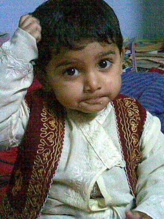

<!-- Banner -->

  

Peace be upon you. I'm Shaad.

That's me on the right, a long time ago. 
I'm still working on something he'd be proud of.

The moon has no light of its own. It gives back what it receives. 
So I try to be worth reflecting.

I don't know how much time I have. I'd like to use it well.

~ shaad

 

[madebyshaad.com](https://madebyshaad.com)
